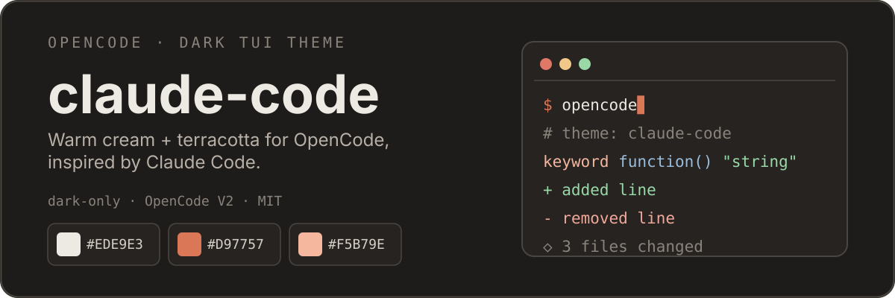

<p align="center">
  
</p>

# claude-code

[](./LICENSE)
[](https://opencode.ai/docs/themes/)
[](./claude-code.json)

A dark [OpenCode](https://opencode.ai) TUI theme in Claude Code's visual voice:
warm cream text on near-black brown, terracotta orange actions.

## Palette

Real values from [`claude-code.json`](./claude-code.json) (`dark.hue`):

| Role | Hex | Used for |
| --- | --- | --- |
| Background | `#1E1C1A` | editor background |
| Text | `#EDE9E3` | primary text (14.05:1 on bg) |
| Muted | `#B8B0A7` | secondary text (7.93:1 on bg) |
| Accent | `#D97757` | actions, keywords, headings |
| Accent light | `#F5B79E` | highlighted/selected text (9.83:1 on bg) |
| Green | `#9AD8A8` | strings, success, diff added |
| Red | `#F2A89B` | variables, errors, diff removed |

Full ramps (100–900) for `gray, red, orange, yellow, green, cyan, blue, purple`
plus `accent → orange`, `interactive → orange`, `neutral → gray` live in the file.

## Install (manual)

Copy the file to your themes directory. OpenCode reads `.json` files only;
the filename becomes the theme name.

| OS | Global directory |
| --- | --- |
| Windows | `%USERPROFILE%\.config\opencode\themes\` |
| macOS / Linux | `~/.config/opencode/themes/` |

Project-only alternative: `.opencode/themes/` inside the project tree.

Then restart the TUI and run `/themes` → select `claude-code`, or set it in
`cli.json`:

```json
{
  "theme": { "name": "claude-code", "mode": "dark" }
}
```

## Install via your AI agent

Copy the prompt below and paste it into your coding agent. It downloads this
theme, validates it, and installs it without touching anything else.

```text
Install the "claude-code" OpenCode theme from GitHub.

1. Download https://raw.githubusercontent.com/HyperTechDevelopment/opencode-claude-code-theme/main/claude-code.json
2. Parse it as JSON and verify: top-level keys "base" and "dark" exist;
   "base" contains text, background, diff, syntax and markdown;
   "dark.hue" contains accent, interactive and neutral.
   Abort with the validation error if any check fails.
3. Create the global themes directory if missing
   (Windows: %USERPROFILE%\.config\opencode\themes\
   macOS/Linux: ~/.config/opencode/themes/)
   and save the file there as claude-code.json.
4. Do NOT modify cli.json, opencode.json, or any existing theme file.
5. Tell me to restart the TUI and run /themes to select claude-code,
   and report the validation results.
```

## What's inside

```text
opencode-claude-code-theme/
├── claude-code.json     # the theme (dark-only, OpenCode V2 format)
├── assets/readme/hero.svg
├── README.md
└── LICENSE              # MIT
```

## Compatibility and limits

- OpenCode **V2 only** (`base` + `dark.hue` token format).
- **Dark only**: if `light` mode is requested, OpenCode falls back to this `dark` palette.
- Adding the file never overwrites built-in themes. Selecting it is reversible
  in one step via `/themes`.

## Validate

```sh
python -c "import json; d=json.load(open('claude-code.json')); print(sorted(d)), sorted(d['dark']['hue']))"
```

Expected: `['base', 'dark']` plus the hue families
(`accent, blue, cyan, gray, green, interactive, neutral, orange, purple, red, yellow`).

## License

[MIT](./LICENSE) © 2026 Marcos Gabriel.
