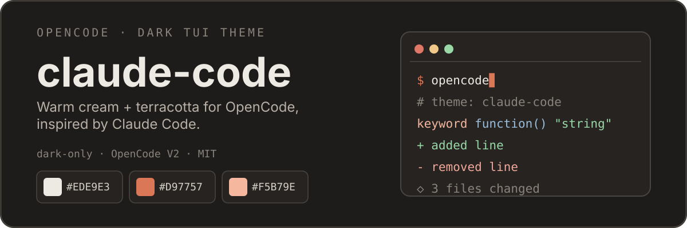

<p align="center">
  
</p>

# claude-code

[English](./README.md)

[](./LICENSE)
[](https://opencode.ai/docs/themes/)
[](./claude-code.json)

Tema escuro para o TUI do [OpenCode](https://opencode.ai) com a paleta do
Claude Code: texto creme `#EDE9E3` sobre `#1E1C1A`, destaques terracota `#D97757`.

## Paleta

Valores idênticos aos de [`claude-code.json`](./claude-code.json) (`dark.hue`):

| Função | Hex | Onde aparece |
| --- | --- | --- |
| Fundo | `#1E1C1A` | fundo do editor |
| Texto | `#EDE9E3` | texto principal (14.05:1 sobre o fundo) |
| Secundário | `#B8B0A7` | texto de apoio (7.93:1 sobre o fundo) |
| Destaque | `#D97757` | ações, keywords, títulos |
| Destaque claro | `#F5B79E` | texto selecionado (9.83:1 sobre o fundo) |
| Verde | `#9AD8A8` | strings, sucesso, diff adicionado |
| Vermelho | `#F2A89B` | variáveis, erros, diff removido |

Rampas 100–900 para `gray, red, orange, yellow, green, cyan, blue, purple`;
aliases `accent → orange`, `interactive → orange`, `neutral → gray` no arquivo.

## Decisões de desenho

- Um único acento quente responde por toda interação (`accent` e `interactive`
  resolvem para laranja), como o terracota do Claude Code.
- A sintaxe mantém um hue por categoria (keyword laranja, função azul, string
  verde) para leitura rápida; comentários ficam apagados.
- Só dark: uma paleta para manter. Pedido de modo `light` cai nesta paleta.

## Instalação (manual)

Copie o arquivo para o diretório de temas. O OpenCode lê apenas `.json`;
o nome do arquivo vira o nome do tema.

| SO | Diretório global |
| --- | --- |
| Windows | `%USERPROFILE%\.config\opencode\themes\` |
| macOS / Linux | `~/.config/opencode/themes/` |

Alternativa só do projeto: `.opencode/themes/` na raiz do projeto.

Reinicie o TUI, rode `/themes`, selecione `claude-code`. Ou fixe em `cli.json`:

```json
{
  "theme": { "name": "claude-code", "mode": "dark" }
}
```

## Instalação pelo seu agente de IA

O prompt abaixo está em inglês de propósito: cole no seu coding agent. Ele
baixa o tema, valida e instala sem tocar em mais nada.

```text
Install the "claude-code" OpenCode theme from GitHub.

1. Download https://raw.githubusercontent.com/HyperTechDevelopment/opencode-claude-code-theme/main/claude-code.json
2. Parse it as JSON and verify: top-level keys "base" and "dark" exist;
   "base" contains text, background, diff, syntax and markdown;
   "dark.hue" contains accent, interactive and neutral.
   Abort with the validation error if any check fails.
3. Create the global themes directory if missing
   (Windows: %USERPROFILE%\.config\opencode\themes\
   macOS/Linux: ~/.config/opencode/themes/)
   and save the file there as claude-code.json.
4. Do NOT modify cli.json, opencode.json, or any existing theme file.
5. Tell me to restart the TUI and run /themes to select claude-code,
   and report the validation results.
```

## Marca

<p>
  
</p>

Chevron mais cursor de bloco, os dois glifos que um tema de terminal mostra.
O piscar de 1.6 s está especificado em
[`claude-code-logo-motion.md`](./assets/readme/claude-code-logo-motion.md);
o recipe determinístico de render está em
[`claude-code-logo-animation.mjs`](./assets/readme/claude-code-logo-animation.mjs).

## Conteúdo

```text
opencode-claude-code-theme/
├── claude-code.json                  # o tema (só dark, formato OpenCode V2)
├── assets/readme/
│   ├── hero.svg                      # hero do README
│   ├── claude-code-logo.svg          # marca (master validado)
│   ├── claude-code-logo-motion.md    # especificação do piscar
│   └── claude-code-logo-animation.mjs# recipe determinístico de frames
├── README.md
├── README.pt-BR.md
└── LICENSE                           # MIT
```

## Problemas comuns

- Tema não aparece: reinicie o TUI depois de copiar o arquivo. O OpenCode lê
  `themes/` na inicialização.
- Tema com cara errada: valide o JSON (comando abaixo). Arquivo inválido é
  ignorado e o tema anterior continua ativo.
- Modo `light` pedido: cai nesta paleta dark por desenho.

## Compatibilidade e limites

- Somente OpenCode **V2** (formato `base` + `dark.hue`).
- **Só dark** por desenho.
- Adicionar o arquivo nunca sobrescreve temas built-in. Trocar de tema é
  reversível em um passo via `/themes`.

## Validação

```sh
python -c "import json; d=json.load(open('claude-code.json')); print(sorted(d), sorted(d['dark']['hue']))"
```

Esperado: `['base', 'dark']` mais as famílias de hue
(`accent, blue, cyan, gray, green, interactive, neutral, orange, purple, red, yellow`).

## Licença

[MIT](./LICENSE) © 2026 Marcos Gabriel.
